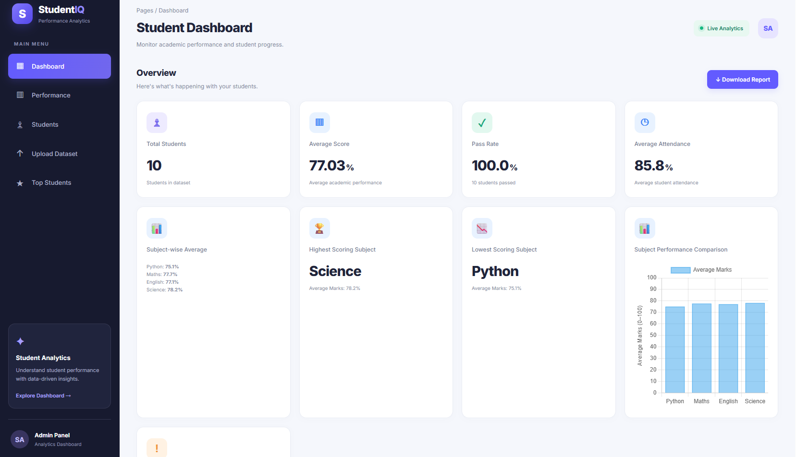
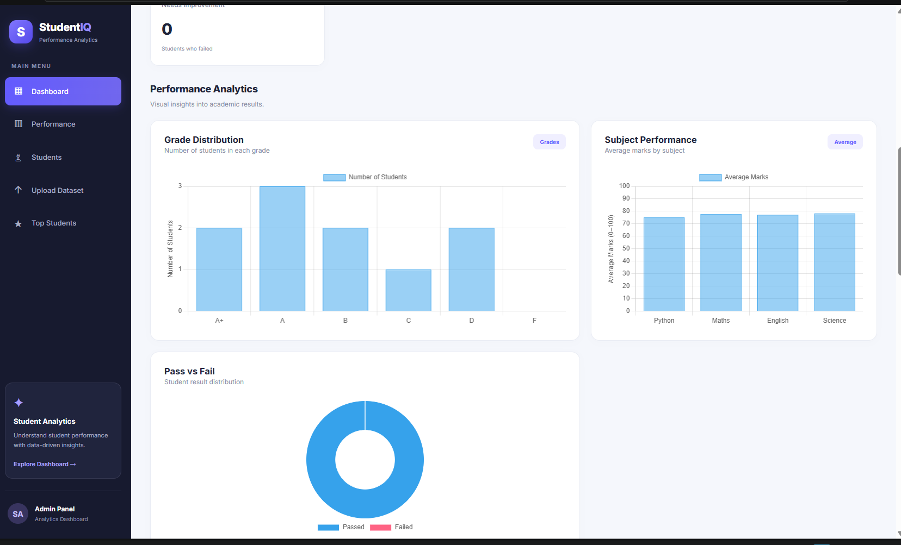
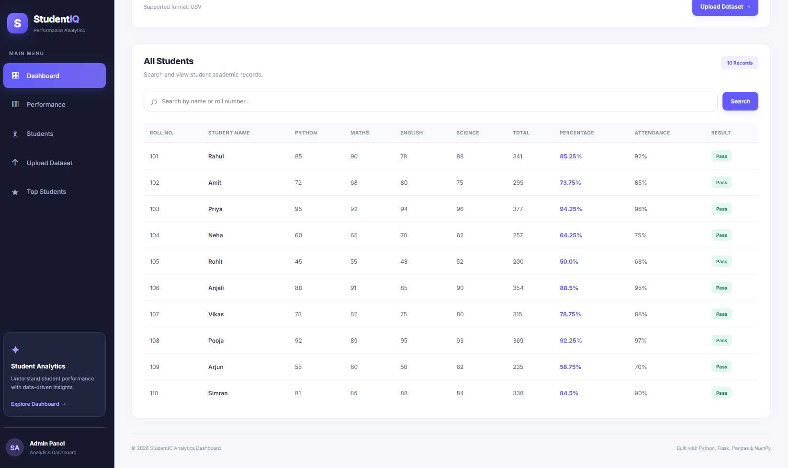

# StudentIQ — Student Performance Analyzer

A Python-based web application built using Flask, Pandas, and NumPy to analyze student academic performance. StudentIQ helps users evaluate marks, attendance, percentages, and pass/fail results through a web dashboard.

## Features

* **CSV Upload:** Upload student records using CSV files.
* **Data Validation:** Validate required columns and reject invalid data.
* **Student Analytics:** Calculate total marks, percentages, and performance statistics.
* **Pass/Fail Analysis:** Determine student results according to the application's rules.
* **Attendance Analysis:** Analyze student attendance and calculate average attendance.
* **Subject Analysis:** Calculate subject-wise averages and identify highest and lowest-performing subjects.
* **Student Search:** Search for students by name.
* **Report Download:** Download student performance reports.
* **Upload Protection:** Enforce file validation and a maximum limit of 10,000 student records per upload.
* **Automated Testing:** Test application functionality and error-handling scenarios using pytest.

## Tech Stack

* **Language:** Python
* **Web Framework:** Flask
* **Data Analysis:** Pandas, NumPy
* **Frontend:** HTML, CSS, JavaScript
* **Testing:** pytest, pytest-cov
* **Version Control:** Git and GitHub

## Requirements

* Python 3.11 or a compatible Python version
* Git
* pip

## Installation and Setup

### 1. Clone the repository

```bash
git clone https://github.com/vikashkumar12a/StudentIQ.git
cd StudentIQ
```

### 2. Create a virtual environment

```bash
python -m venv venv
```

### 3. Activate the virtual environment

**Windows Command Prompt:**

```cmd
venv\Scripts\activate
```

**Windows PowerShell:**

```powershell
.\venv\Scripts\Activate.ps1
```

### 4. Install dependencies

```bash
python -m pip install -r requirements.txt
```

## Run the Application

Start the Flask application:

```bash
python app.py
```

Open the local URL displayed in your terminal in a web browser.

## Run Tests

Run all application tests:

```bash
python -m pytest tests/test_app.py -v
```

Run tests with code coverage:

```bash
python -m pytest --cov=app --cov-report=term-missing
```

## Project Structure

```text
StudentIQ/
├── app.py
├── data/
├── static/
│   ├── script.js
│   └── style.css
├── templates/
│   └── index.html
├── tests/
│   └── test_app.py
├── requirements.txt
├── README.md
└── .gitignore
```

## Future Improvements

* Add more advanced student performance analytics.
* Improve data visualization and reporting.
* Add more automated tests.
* Introduce secure multi-user support.

## Disclaimer

StudentIQ is an educational project intended for learning, student data analysis, and portfolio demonstration.

## Screenshots

### Dashboard



### Performance Analysis



### Student Records


